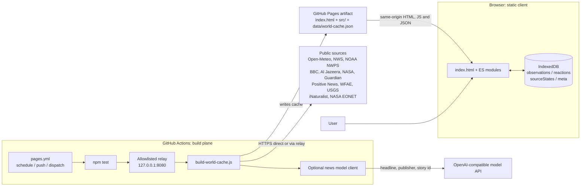
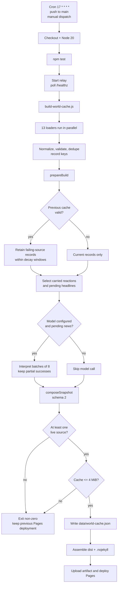
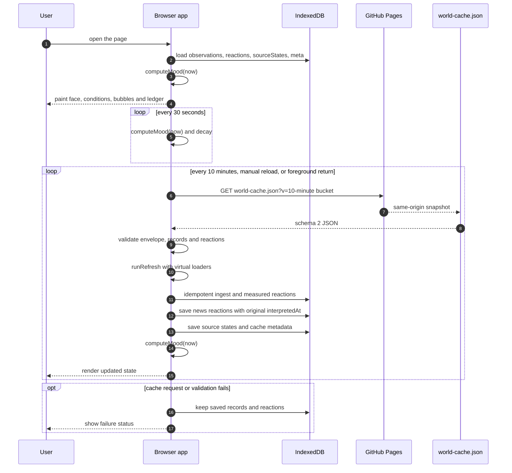
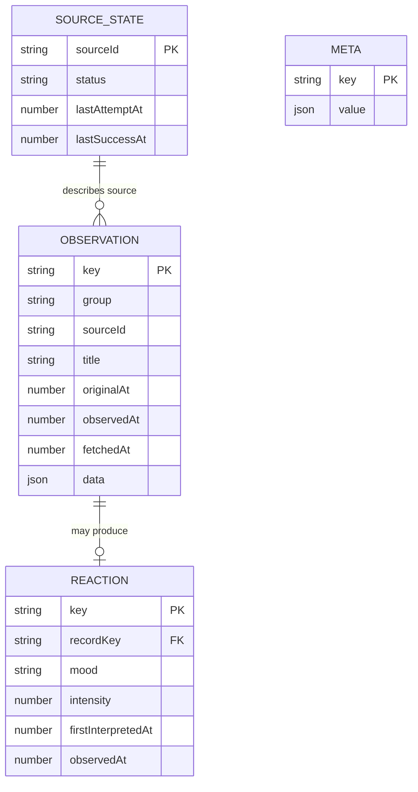
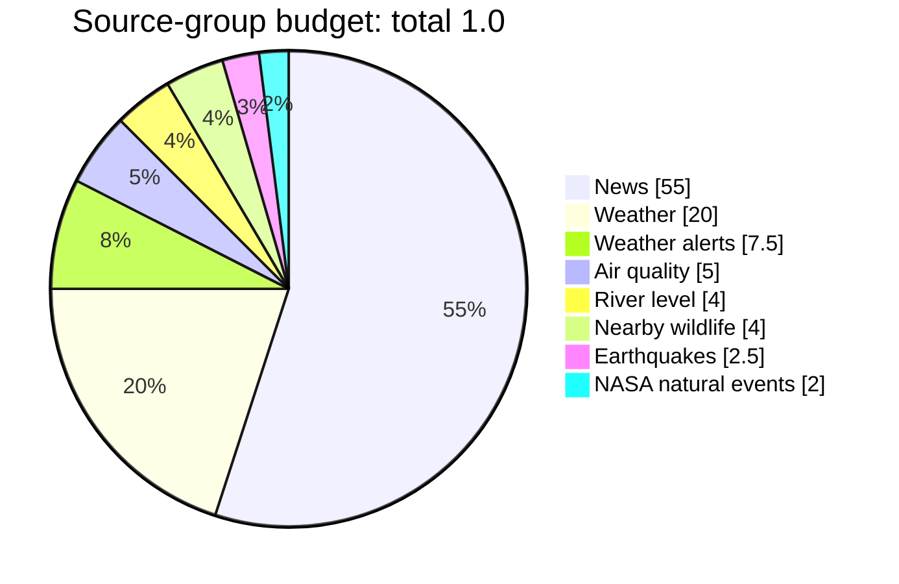
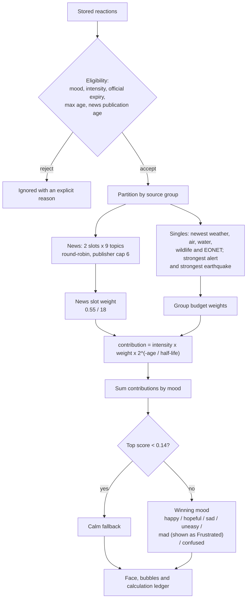

# Murmur: a clock-driven emotional interface for a public world

**Technical design paper**<br>
Repository: <https://github.com/slayyyyer/murmur><br>
Implementation snapshot: the tree containing this document

> Murmur is a fiction with a clock. It does not feel anything, verify
> headlines, or understand the places it reads about. Its mood is a simulated
> emotional state calculated in the browser from an hourly public-data
> snapshot. It is not a measurement of public opinion, a factual summary, or a
> prediction.

---

## Abstract

Murmur is a small animated face in Charlotte, North Carolina. It reacts to
weather, official weather alerts, modeled air quality, a nearby river gauge,
world and local news, earthquakes, nearby wildlife observations, and open
natural events. The implementation deliberately separates two problems:

1. **Build-time acquisition.** GitHub Actions fetches and validates the public
   world once an hour, optionally asks a language model to interpret new
   headlines, and writes one static JSON cache.
2. **Browser-time interpretation.** The browser downloads only that same-origin
   cache, stores observations and reactions in IndexedDB, and recomputes a
   decaying mood every thirty seconds.

The result is a static site with no production server, no runtime third-party
scripts, and no API keys in the browser. The emotional model is auditable:
every active influence has a source, a weight, an age, a decayed contribution,
and a stated reason when it is ignored.

This paper describes the architecture, build system, cache contract, browser
runtime, emotion model, failure semantics, privacy properties, and test
strategy. The diagrams are also available as editable Mermaid sources in
[`docs/diagrams/`](diagrams/).

---

## Contents

1. [Design goals and non-goals](#1-design-goals-and-non-goals)
2. [System at a glance](#2-system-at-a-glance)
3. [Sources and normalization](#3-sources-and-normalization)
4. [The build system](#4-the-build-system)
5. [The cache contract](#5-the-cache-contract)
6. [The browser runtime](#6-the-browser-runtime)
7. [The emotion model](#7-the-emotion-model)
8. [Failure semantics](#8-failure-semantics)
9. [Privacy, security, and accessibility](#9-privacy-security-and-accessibility)
10. [Testing and verification](#10-testing-and-verification)
11. [Limitations](#11-limitations)
12. [Conclusion](#12-conclusion)
13. [Appendix A: constants](#appendix-a-constants)
14. [Appendix B: file map](#appendix-b-file-map)
15. [Appendix C: running and rebuilding](#appendix-c-running-and-rebuilding)

---

## 1. Design goals and non-goals

Murmur is a designed artifact, not a general-purpose sentiment engine. The
implementation follows a small set of constraints.

| Goal | Implementation |
| --- | --- |
| Static production deployment | Plain HTML, CSS, and ES modules; the build artifact is served by GitHub Pages |
| No browser-side source fetching | The browser requests only `data/world-cache.json` from its own origin |
| No credentials in the client | The optional model key exists only in the GitHub Actions runner |
| Independent source failure | One loader, deadline, byte ceiling, and status per source or publisher |
| No invented fallback data | Empty, malformed, unavailable, and cached states are shown as such |
| Auditable mood | Budgets, slot selection, decay, support, and ignored reasons are exposed in the UI |
| Clock-driven decay | Stored reactions age from observation or first interpretation, not page load |
| Idempotent persistence | Re-seeing the same observation never creates a second reaction or resets its age |
| Privacy by minimization | No accounts, analytics, third-party runtime scripts, or precise wildlife locations |
| Accessibility | Semantic structure, labelled SVG faces, live regions, keyboard controls, and reduced motion |

**Non-goals.** Murmur does not determine whether a headline is true, measure
how anyone actually feels, estimate public mood, summarize the news, predict
events, or claim that a distant event is safe or dangerous for Charlotte.
Environmental rules are hand-written interpretations of one reading, not
analysis. The face is an interface fiction.

---

## 2. System at a glance

Murmur has three planes:

- **Build plane.** GitHub Actions runs `pages.yml`, tests the repository,
  starts the allowlisted relay, runs `scripts/build-world-cache.js`, and
  optionally calls an OpenAI-compatible model.
- **Delivery plane.** The workflow assembles `dist/`, uploads it as a Pages
  artifact, and deploys the saved artifact. The cache and app files are served
  from the same origin.
- **Runtime plane.** A browser loads the static app, validates the cache,
  persists records and reactions in IndexedDB, and computes mood locally.



*Editable source: [`docs/diagrams/system-context.mmd`](diagrams/system-context.mmd).*

The important boundary is the **cache**. The build plane can be complex and
failure-prone; the browser sees one validated JSON document and a set of saved
reactions. The browser never needs CORS permission from a publisher, never
holds a model key, and never talks to the relay.

### Why a relay exists

Most sources are reachable directly from a CI runner, but several news
publishers do not send permissive CORS headers and the USGS feed benefits from
an IPv4 preference. `proxy/server.js` exposes exactly one route:

```text
GET /api/proxy?url=<allowlisted HTTPS URL>
```

`proxy/allowlist.js` permits a narrow set of origins and path prefixes. The
relay accepts only `GET` and `HEAD`, requires HTTPS with no credentials, an IP
literal, or a non-default port, rejects `..` paths, validates redirects against
the same allowlist, uses a twelve-second deadline and a three-megabyte ceiling,
accepts only feed/JSON/text content types, sets no cookies, and returns
`no-store`. It runs in Actions and local cache generation; the deployed browser
never calls it.

---

## 3. Sources and normalization

There are thirteen independent loaders. Weather, air, alerts, and the river
gauge are measured or official observations. News is split by publisher so one
publisher's feed failure cannot remove another publisher's stories. Earthquakes,
wildlife, and natural events are global or nearby observation feeds.

| Input | Provider | Build route | Mood group |
| --- | --- | --- | --- |
| Charlotte weather | Open-Meteo | Direct HTTPS | `weather` |
| Modeled air quality | Open-Meteo air-quality API | Direct HTTPS | `air` |
| Weather alerts | National Weather Service | Direct HTTPS | `alerts` |
| River level | NOAA NWPS gauge `02145000` | Direct HTTPS | `water` |
| World, science, technology, business, health, culture | BBC | Relay | `news` |
| All-news feed | Al Jazeera | Relay | `news` |
| Science and space | NASA | Relay | `news` |
| World and topic feeds | The Guardian | Relay | `news` |
| Community and progress | Positive News | Relay | `news` |
| Charlotte and Carolinas | WFAE | Relay | `news` |
| Recent earthquakes | USGS | Relay with IPv4 preference | `earthquake` |
| Nearby wildlife and plants | iNaturalist | Direct HTTPS | `wildlife` |
| Open fires, storms, volcanoes | NASA EONET | Direct HTTPS | `eonet` |

Each loader has its own deadline and byte ceiling in `src/config.js`:
twelve-second fetches, a three-megabyte JSON ceiling, and a two-megabyte feed
ceiling. A loader returns one of four build-time statuses:

- `live`: a fresh response with at least one valid record;
- `empty`: a structurally valid response with no eligible records;
- `malformed`: an invalid envelope, required field, or feed structure;
- `unavailable`: network failure, timeout, HTTP error, or missing relay.

Normalization is deliberately conservative. Missing numeric values are not
coerced to zero. News links must be safe HTTPS URLs. Dates must parse. USGS
coordinates must be valid and the magnitude must be in range. EONET keeps only
open fires, severe storms, and volcanoes. iNaturalist keeps research-grade,
licensed, non-captive observations and strips observer identity, photos, place
guesses, and precise coordinates. Invalid entries are counted separately from
legitimate exclusions.

RSS and Atom parsing is dependency-free. It rejects missing channels,
unclosed root/channel elements, truncated items, and items without a usable
headline and link. A malformed-only feed is not reported as a successful empty
feed.

---

## 4. The build system

### 4.1 Workflow

`.github/workflows/pages.yml` runs at minute 17 of every hour, on every push to
`main`, and on manual dispatch. It uses Node 20 and the repository's package
scripts.



*Editable source: [`docs/diagrams/build-pipeline.mmd`](diagrams/build-pipeline.mmd).*

The workflow deploys only after the cache build succeeds. If no source returns
a `live` response, the builder exits non-zero and the previously deployed
Pages artifact remains online. Partial source failures still deploy. The model
is optional and its failure is not a build failure.

### 4.2 Fetch, normalize, and deduplicate

`scripts/build-world-cache.js` creates all loaders through
`createLoaders()` and runs them with `runRefresh()` against an in-memory store.
`runRefresh()` wraps each loader in its own `try`/`catch`, so a thrown adapter
becomes that source's `unavailable` or `malformed` outcome rather than a failed
build. Records are deduplicated by stable keys, then passed into the snapshot
planner.

The builder distinguishes **current records** from **retained history**:

- A successful `live` or `empty` response does not inherit previous records.
- A failed source (`malformed` or `unavailable`) may retain previous validated
  records while they remain inside their own decay window.
- For a news publisher, a single failed feed inside an otherwise live publisher
  also marks the source as failed for this decision; healthy current stories
  are merged with still-valid previous stories.
- Per-source output is capped at 250 records.
- Retention checks use the record's observation time, its group maximum age,
  and for alerts the official expiry time.
- USGS scans the full feature list and reserves the strongest eligible
  earthquake in its final 120-record output, so a burst of tiny recent events
  cannot hide a major one.

The previous snapshot is read from a local `data/world-cache.json` if one
exists, and otherwise from `PREVIOUS_CACHE_URL` when configured. It is
validated with the same browser cache validator before any of its history is
trusted.

The source entry records both the current attempt time (`fetchedAt`) and the
last successful acquisition (`lastSuccessAt`). The failure status and error stay
visible even when old records survive. The browser maps that combination to a
separate `cached` display state, so "we have older records" is not confused with
"the current fetch succeeded."

News reactions are retained only when their story is still present in the
included records and the reaction is still within the forty-eight-hour news
window. Their original `interpretedAt` is preserved. This is what allows a
temporary feed disappearance and recovery to avoid restarting the story's age.

### 4.3 Optional news interpretation

News is the only source that needs a language model. The model is never used
to create a measured-source reaction. The builder selects new headlines from
the last forty-eight hours that do not already have a carried reaction, caps the
default run at twenty-four headlines, and interprets them in batches of eight.

The request contains only the headline, publisher, and story ID. The prompt
marks the headline JSON as untrusted data and forbids following instructions
inside it. The response is accepted only when it is valid JSON with known story
IDs, no duplicates, a mood from `happy`, `hopeful`, `sad`, `uneasy`, `mad`, or
`confused`, an intensity from zero to one, and a short text with no URL, digits,
quotation marks, or unsupported claims about casualties, damage, or safety.
`calm` is not a valid model label.

If one batch fails, the builder keeps successful batches and records the first
error. The resulting model metadata can say `partial: true` while still
publishing measured sources and the reactions that survived. A missing key, an
HTTP error, malformed JSON, a timeout, or a response with no usable reactions
therefore produces a quieter mood, not a broken page.

### 4.4 Compose and publish

`composeSnapshot()` produces schema version 2:

- source entries, including failure status, retained-record count, and
  `lastSuccessAt`;
- new and carried `newsReactions`, each with its original interpretation time;
- `newsModel` metadata: provider, model, configured, available, error, partial,
  counts, and generation time;
- the top-level `generatedAt` and schema version.

The builder refuses to write a cache larger than four mebibytes. It writes
`data/world-cache.json`, then the workflow copies only `index.html`,
`styles.css`, `src/`, and the generated cache into `dist/`, adds `.nojekyll`,
uploads the artifact, and deploys it. The cache is generated, not committed.

---

## 5. The cache contract

The cache is the contract between the build plane and the browser. A
representative shape is:

```json
{
  "schemaVersion": 2,
  "generatedAt": 1761945102029,
  "newsModel": {
    "provider": "Z.ai",
    "model": "glm-4.5-flash",
    "configured": true,
    "available": true,
    "error": null,
    "partial": false,
    "reactionCount": 1,
    "interpretedThisRun": 1,
    "carriedThisRun": 0,
    "rejectedThisRun": 0,
    "generatedAt": 1761945102029
  },
  "newsReactions": [
    {
      "sourceId": "news:abc123",
      "mood": "hopeful",
      "intensity": 0.4,
      "text": "Encouraged by people choosing to cooperate.",
      "interpretedAt": 1761945102029
    }
  ],
  "sources": [
    {
      "sourceId": "weather",
      "label": "Charlotte weather",
      "provider": "Open-Meteo forecast API",
      "homepage": "https://open-meteo.com/",
      "group": "weather",
      "status": "live",
      "error": null,
      "fetchedAt": 1761945102029,
      "lastSuccessAt": 1761945102029,
      "carriedRecords": 0,
      "records": []
    }
  ]
}
```

`src/app/worldCache.js` validates the document before any of it reaches
IndexedDB. The envelope checks include:

- schema version 1 or 2;
- a valid generation time that is not implausibly in the future;
- one to twenty known sources, with no duplicates;
- a valid status or an explicit `malformed` result;
- at most 250 records per source, with known source/group pairs;
- HTTPS record links, safe titles, valid original timestamps, optional
  observation/update timestamps, and a maximum of 2,000 bytes of per-record
  `data`;
- for news, a known topic;
- cached news reactions with a known story key, a model-valid mood, an
  intensity from zero to one, safe text, and a mandatory `interpretedAt`.

Invalid records are dropped individually. An invalid envelope is rejected so
it cannot overwrite a good saved mood. Schema 1 caches remain readable with no
news reactions. The validator exposes `invalidRecords` and `invalidReactions`
rather than silently treating them as live data.

The cache URL is versioned with a ten-minute bucket:

```text
data/world-cache.json?v=<floor(now / 10 minutes)>
```

This matches GitHub Pages' ten-minute asset cache. The UI shows the cache's
actual generation time, and a cache older than two hours is labelled stale.
The browser checks again every ten minutes, on manual reload, and when the tab
returns to the foreground.

---

## 6. The browser runtime

The browser is a static ES-module application. It has no framework, no runtime
dependencies, and no server process. Its local database is IndexedDB
(`murmur`, version 1) with four object stores: `observations`, `reactions`,
`sourceStates`, and `meta`. If IndexedDB cannot open, the same repository API is
backed by an in-memory store, and the interface says that saved moods will not
survive a reload.



*Editable source: [`docs/diagrams/browser-runtime.mmd`](diagrams/browser-runtime.mmd).*

### 6.1 Refresh

`main.js` calls `loadWorldCache()`, then converts each validated snapshot source
into a small virtual loader for `runRefresh()`. The browser does not fetch the
original source URLs. This keeps CORS, redirects, credentials, and publisher
availability out of the browser.

The refresh sequence is:

1. validate the cache and its news reactions;
2. ingest validated observations idempotently;
3. create measured reactions for weather, alerts, air, water, wildlife,
   earthquakes, and EONET;
4. save cached news reactions only for stories that were ingested;
5. derive visible source states, including `cached` when a failed source still
   has retained records;
6. save source states and cache metadata;
7. recompute mood from all saved reactions.

Measured reactions are deterministic functions of one record. News reactions
are never invented in the browser; they exist only if the build-time model
produced them and the cache validator accepted them.

### 6.2 Persistence and idempotency

Observations are keyed by their stable source key. `mergeRecord()` preserves
the earliest known original date and the latest observation/update time while
letting incoming title, URL, summary, and data win. Reactions are keyed by
`reaction:<record key>` and are written with `saveReactionIfAbsent()`.

As a consequence, reloading the page, checking for a new cache, polling, or
seeing the same observation again:

- does not create a second reaction;
- does not change its intensity;
- does not reset its first interpretation time;
- does not strengthen it.

For repeated wildlife and natural-event IDs, the stored original date is the
earliest date ever observed, even if upstream history shifts. The latest
observation time may advance, but the identity of the record does not.

### 6.3 The local clock

`computeMood()` is recalculated every thirty seconds from the stored reactions.
No network request is required for the face to fade. This is why a weather
observation made six hours ago no longer contributes even if the page has just
been opened, and why a news reaction ages from its first interpretation rather
than from the current page load.

The local data model is:



*Editable source: [`docs/diagrams/data-model.mmd`](diagrams/data-model.mmd).*

---

## 7. The emotion model

### 7.1 Representation

A stored reaction has the public shape:

```js
{ sourceId, mood, intensity, text }
```

plus bookkeeping needed for decay, selection, links, and explanation:
`recordKey`, `group`, `publisher`, `publisherLabel`, `topic`, `observedAt`,
`originalAt`, `firstInterpretedAt`, `magnitude`, `severity`, `expiresAt`,
`title`, and `url`.

The supported moods are:

| Mood | Display | Typical use |
| --- | --- | --- |
| `happy` | Happy | Clear weather, good air, a nearby wildlife observation |
| `hopeful` | Hopeful | News about recovery, cooperation, care, or progress |
| `sad` | Sad | Rain, cold, unhealthy air, moderate or major flooding, heavy news |
| `uneasy` | Uneasy | Storms, alerts, high water, strong earthquakes, fires or storms |
| `mad` | Frustrated | Heat, unfairness, very unhealthy air; never hatred |
| `confused` | Confused | Fog, unusual snow, contradictions or missing clarity |
| `calm` | Calm | Low-intensity measured notes or the low-score fallback |

`mad` is stored under that key but displayed as **Frustrated**. `calm` is not a
valid model label. It can be produced by a low-intensity measured rule, and the
engine also falls back to it when the strongest aggregate mood is below the
calm threshold.

### 7.2 Budgets and news slots

Each source group has a maximum share of the mood. The shares sum to one:



*Editable source: [`docs/diagrams/mood-budgets.mmd`](diagrams/mood-budgets.mmd).*

| Group | Budget | Half-life | Expires |
| --- | ---: | ---: | ---: |
| News | 55% | 6 h | 48 h after publication and 48 h after first interpretation |
| Weather | 20% | 3 h | 6 h after observation |
| Weather alerts | 7.5% | 3 h | 24 h after issue or official expiry, whichever is sooner |
| Air quality | 5% | 3 h | 6 h after observation |
| River level | 4% | 6 h | 24 h after gauge reading |
| Nearby wildlife | 4% | 24 h | 7 days after observation |
| Earthquakes | 2.5% | 6 h | 24 h after origin time |
| NASA natural events | 2% | 24 h | 7 days after latest observation |

Missing inputs leave their budget unused. They never redistribute weight to
another source. A quiet source therefore makes the face quieter, not more
reactive.

News is different because one headline should not consume the entire news
budget. There are two slots for each of nine topics, for eighteen slots. Each
slot is worth:

```text
0.55 / 18 = 0.0305556  (about 3.06% of the whole mood)
```

Slots are filled round-robin: slot one for every topic first, then slot two.
Within a topic, the second slot prefers a different publisher. One publisher
may hold at most six active stories. If a slot has no eligible story, that share
is unused.

### 7.3 Which records may influence the face

Before weighting, every saved reaction passes an eligibility check:

- the group must be known;
- the mood must be one of the seven supported moods;
- the intensity must be finite and between zero and one;
- an alert must not have passed its official expiry;
- the reaction must have a finite age;
- a news story must still be within the publication window;
- the reaction must not exceed its group's maximum age.

News ages from `firstInterpretedAt`. Measured sources age from `observedAt`,
falling back to `originalAt` and then `firstInterpretedAt`. This prevents a
late model interpretation from making an old article young, and prevents a
fresh cache fetch from resetting the age of a measurement.

After eligibility:

- **News** goes through the eighteen-slot selection described above.
- **Weather, air, water, wildlife, and EONET** contribute at most once each:
  the newest eligible reaction.
- **Alerts** contribute at most once: the strongest by severity
  (`Extreme`, `Severe`, `Moderate`, `Minor`, then `Unknown`).
- **Earthquakes** contribute at most once: the strongest by magnitude.

Other records remain browsable in Explore and in the calculation ledger, but
they cannot multiply a group's influence.

### 7.4 Contribution and aggregation

Each active reaction has a contribution:

```text
contribution = intensity × weight × 2^(-ageHours / halfLifeHours)
```

The intensity is bounded to `[0, 1]`; the weight is either the group budget or
the news slot weight; the exponential term is the decay factor. Examples:

- A news story at intensity `0.8`, age `3 h`, half-life `6 h`:
  `0.8 × 0.0305556 × 2^(-0.5) ≈ 0.0173`.
- Clear weather at intensity `0.6`, age `1.5 h`, half-life `3 h`:
  `0.6 × 0.20 × 2^(-0.5) ≈ 0.0849`.

Contributions are summed **by mood**, not by source. If both examples were
happy, the happy score would be about `0.1022`. The highest-scoring mood wins,
with ties broken by the fixed mood order. If the highest score is below
`0.14`, the displayed mood is **Calm** even if the leading measured note used a
different label.

The threshold remains above any single measured source. Clear weather alone can
contribute at most `0.12` (`0.20 × 0.6`), below the cutoff. This is intentional:
the face is not meant to become emphatically happy because one source is
pleasant. A clear day with excellent air and a nearby wildlife observation
reaches `0.1575`, so a genuinely good combination can move the face to
**Happy**.



*Editable source: [`docs/diagrams/mood-model.mmd`](diagrams/mood-model.mmd).*

The UI exposes the same calculation: each emotion's score, each active
contribution, each group's budget and use, the eighteen news slots, publisher
counts, ignored records and reasons, and the current decay window. A mood is
therefore explainable without inspecting the browser console.

---

## 8. Failure semantics

Murmur prefers an honest degraded state to a fabricated complete one.

| Situation | Build behavior | Browser behavior |
| --- | --- | --- |
| One source times out or returns HTTP 500 | Source is `unavailable`; other loaders continue | Old saved records remain; source may show `cached` |
| A source has only malformed entries | Source is `malformed`, not silently empty | Error and retained history are visible |
| A feed is structurally valid but has no eligible stories | Source is `empty`; previous history is not inherited | Empty status is shown |
| One news feed fails while another publisher feed works | Publisher source is retained with current and prior valid records | `cached` or `live` is shown according to the surviving records |
| News model is missing or fails | Measured sources still build; new reactions are empty; carried reactions remain | News mood is labelled unavailable; measured mood continues |
| One model batch fails after another succeeds | Successful batch reactions are kept; `partial` and the first error are recorded | Partial notice is shown |
| Cache request or validation fails | Not applicable | Saved records/reactions remain; failure is labelled |
| Cache is older than two hours | Build may still have succeeded earlier | Stale label is shown |
| No source returns live data | Builder exits non-zero | Previous Pages deployment remains online |

The builder also distinguishes **failed** from **successfully empty** for the
purpose of history. A failed source may inherit still-valid records. An empty
successful source may not. That is why an outage does not erase the last known
weather or headline, while a genuinely quiet feed does not keep stale stories
alive.

The interface never substitutes demo data. Empty bubbles say they are empty;
missing conditions stay missing; a source with no current response is marked
as such.

---

## 9. Privacy, security, and accessibility

**Privacy.** Murmur has no accounts, analytics, trackers, or third-party
runtime scripts. The browser downloads one same-origin JSON cache and stores
observations and reactions locally. The hourly cache contains only public
records. Wildlife entries keep the taxon, a coarse distance rounded to 5 km
(or 10/100 km farther away), the observation link, and dates; observer
identities, photos, place guesses, and precise coordinates are removed. The
browser never sends headlines anywhere.

**Model boundary.** Only the GitHub Actions runner reads the model key. The
model receives the headline, publisher, and story ID, not article bodies. The
output is validated before it can enter the cache. The key is never placed in
the cache, browser code, client storage, or logs.

**Relay boundary.** The relay is for local development and CI. It has no
authentication or rate limiting and must not be exposed to the public internet.
Its allowlist, redirect check, HTTPS requirement, content-type check, deadline,
byte ceiling, and security headers reduce the blast radius of a bad URL.

**Accessibility.** The interface uses semantic landmarks, headings, lists,
tables, and native `<details>`/`<summary>`. Every face has an SVG `<title>` and
`<desc>`, with unique IDs for the live and preview faces. Mood changes are
announced through a polite live region; refresh results use a status role.
Controls are keyboard-operable, focus-visible outlines are present, and status
is never conveyed by color alone. `prefers-reduced-motion` and a persistent
**Reduce motion** toggle disable the bob, blink, and transitions.

---

## 10. Testing and verification

The repository has 78 tests and no test framework dependency. The suite uses
Node's built-in assertions and the project's ES modules:

```bash
npm test
# or
bun tests/run.js
```

Coverage is organized around the system's failure boundaries:

- mood arithmetic, budget unspent behavior, news slot allocation, publisher
  caps, decay, and calm fallback;
- eligibility and expiry for every source group;
- record ingestion idempotency, reaction idempotency, restart persistence, and
  earliest/latest date merging;
- source adapters: Open-Meteo time offsets, air-quality bands, NWS alerts, river
  categories, USGS envelopes, iNaturalist eligibility, EONET filtering;
- RSS/Atom parsing, malformed versus empty feeds, unsafe links, duplicate
  headlines, and topic classification;
- required numeric readings that must not turn `null`, `''`, or `false` into
  zero, while preserving a real zero;
- model HTTP failures, invalid responses, timeouts, partial batches, and strict
  output validation;
- cache envelope validation, cached-reaction timestamps, schema 1 compatibility,
  ten-minute cache URLs, and source status derivation;
- multi-build retention: success, outage, recovery, original interpretation
  time, expired history, and model failure metadata.

All tests use deterministic mocks. They do not contact live publishers, the
relay, the model, or GitHub. The build script is also bundled locally with a
Node target as a syntax and module-resolution smoke check. A real hourly
Actions run and a real model response remain deployment-time checks, not test
substitutes.

---

## 11. Limitations

- The face is a fiction. It does not understand news, feel anything, or predict
  anything.
- News reactions require the optional build-time model. Without a key, when the
  model fails, or when no output passes validation, the 55% news budget is
  unused and the face is much quieter by design.
- Environmental reactions are hand-written rules, not analysis.
- Open-Meteo air quality is modeled, not measured by a local sensor.
- EONET is filtered to fires, severe storms, and volcanoes; other categories are
  ignored.
- iNaturalist requests research-grade, licensed, non-captive observations. Some
  eligible observations may be omitted when the API lacks a usable date or link.
- No demo data is included or substituted.
- GitHub cron is best-effort and can be delayed. Scheduled workflows may be
  disabled after prolonged repository inactivity; a manual run re-enables the
  schedule.
- GitHub Pages caches assets for up to ten minutes. The app accounts for this,
  but a newly deployed cache can take up to ten minutes to appear.
- Weather, alerts, and air expire on shorter windows, and the gauge reading
  expires after a day, so a badly delayed cache naturally removes them.
- Feed summaries are publisher-provided and may lag or change. Murmur never
  fetches article pages.
- The relay is not a public service.
- Times use `America/New_York`, including daylight-saving changes.
- A single browser tab owns the data. Multiple tabs can open the same IndexedDB
  database; cache checks are not coordinated between them.

---

## 12. Conclusion

Murmur's architecture is a deliberate split between a complicated, failure-prone
build plane and a small, auditable runtime. GitHub Actions absorbs source
diversity, relay rules, model credentials, retention, and cache validation.
The browser receives one static snapshot, persists it idempotently, and runs a
clock-driven emotional model with explicit budgets and decay.

The emotional model is intentionally modest. It does not claim to know how
anyone feels. It assigns a small, bounded, explainable pull to a public
observation, lets that pull fade, and shows the arithmetic. The result is a
face that can be quiet, uncertain, or affected without pretending to be alive
or authoritative.

---

## Appendix A: constants

| Constant | Value | Location |
| --- | ---: | --- |
| Location | Charlotte, NC, 35.2271, -80.8431 | `src/config.js` |
| Mood groups | 8 | `src/config.js` |
| News topics | 9 | `src/config.js` |
| News slots per topic | 2 | `src/config.js` |
| News slot weight | 0.55 / 18 | `src/config.js` |
| Publisher story cap | 6 | `src/config.js` |
| Calm threshold | 0.14 | `src/config.js` |
| Source fetch deadline | 12 s | `src/config.js`, relay |
| JSON/feed byte ceilings | 3 MiB / 2 MiB | `src/config.js` |
| Cache schema | 2 | `src/config.js` |
| Cache maximum age | 2 h | `src/config.js` |
| Cache request bucket | 10 min | `src/config.js` |
| Browser tick | 30 s | `src/config.js` |
| Automatic cache check | 10 min | `src/config.js` |
| Builder cache ceiling | 4 MiB | `scripts/build-world-cache.js` |
| Maximum source records | 250 | `scripts/build-world-cache.js`, `src/app/worldCache.js` |
| Default model headline cap | 24 | `src/ai/buildNewsModel.js` |
| Default model batch size | 8 | `src/ai/buildNewsModel.js` |
| Default model timeout | 60 s | `src/ai/buildNewsModel.js` |

## Appendix B: file map

```text
index.html                 semantic shell and static controls
styles.css                 design system, face styles, reduced motion
src/
  config.js                location, budgets, decay, feeds, cache URL
  main.js                  bootstrap, refresh, rendering, events
  lib/                     time, validation, feed parsing, dedupe, weather codes
  sources/                 direct and relay-backed adapters
  interpret/               deterministic measured rules and reaction factory
  mood/engine.js           eligibility, slots, caps, aggregation, explanations
  ai/                      build-time model client and strict output validation
  app/                     refresh pipeline, cache validation, snapshot planning
  store/                   IndexedDB, repository, in-memory fallback
  ui/                      face SVG, labels, panels, mood view
scripts/build-world-cache.js   hourly snapshot builder
proxy/                     static server and allowlisted relay
.github/workflows/pages.yml    tests, cache build, artifact, Pages deploy
tests/                     deterministic mood, source, cache, and build tests
docs/                      this paper and editable diagram sources
```

## Appendix C: running and rebuilding

Requirements: Node.js 18.17 or newer, or Bun. There is no install step.

```bash
# Terminal 1: static server plus relay
cd murmur
npm start

# Terminal 2: build a cache through the local relay
MURMUR_PROXY=http://127.0.0.1:8080 npm run cache
```

A model key is optional:

```bash
NEWS_MODEL_API_KEY="..." \
MURMUR_PROXY="http://127.0.0.1:8080" \
npm run cache
```

Then open <http://127.0.0.1:8080>. In production, the same work happens in
GitHub Actions and only the static artifact is deployed. The browser never
receives `MURMUR_PROXY`, a model key, or a publisher URL.

The diagrams in this paper can be exported with Mermaid CLI without adding a
project dependency:

```bash
npx --yes @mermaid-js/mermaid-cli \
  -i docs/diagrams/mood-model.mmd \
  -o mood-model.svg
```
